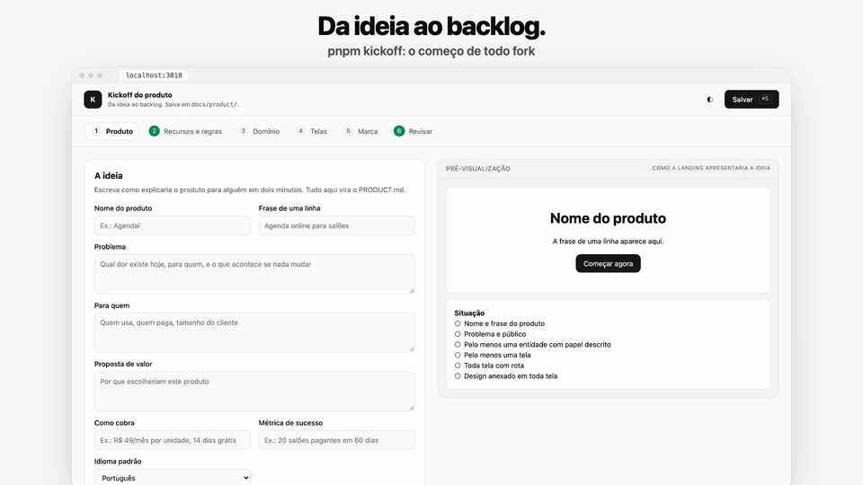

<div align="center">

# 🧱 next-boilerplate

**Monorepo full-stack para criar MVPs em série.**<br/>
Cada produto nasce como um fork, troca marca, domínio e credenciais, e já sai com login, painel, área
admin, assinaturas, e-mails, i18n e LGPD funcionando.

<p align="center">
  <a href="https://nextjs.org"></a>
  <a href="https://react.dev"></a>
  <a href="https://www.typescriptlang.org"></a>
  <a href="https://tailwindcss.com"></a>
  <a href="https://firebase.google.com"></a>
  <a href="https://stripe.com"></a>
  <a href="https://turborepo.com"></a>
  <a href="license.md"></a>
</p>

[🚀 Criar um projeto](docs/FORKING.md) ·
[🎬 Demonstração](#-demonstração) ·
[✨ Funcionalidades](#-o-que-um-fork-herda) ·
[⚡ Começando](#-começando) ·
[✅ Entrega](#-etapa-de-entrega) ·
[📚 Documentação](#-documentação)

</div>

---

> [!TIP]
> **Vai criar um produto novo?** Siga o **[guia de criação e lançamento de projeto](docs/FORKING.md)**. Ele
> lista, em ordem, os arquivos que o fork altera, cada variável de ambiente e o que ela muda, os serviços que
> precisam ser configurados e como publicar em produção. O README do produto nasce do
> **[modelo da casa](docs/templates/README.template.md)**, e nenhum produto é entregue sem passar pela
> **[etapa de entrega](docs/delivery/README.md)**.

## 🎬 Demonstração

<p align="center">
  <a href="apps/web/public/showcase/showcase.mp4">
    
  </a>
</p>

O vídeo completo, com trilha, está em [`apps/web/public/showcase/showcase.mp4`](apps/web/public/showcase/showcase.mp4)
e é servido pela landing em `/showcase/showcase.mp4`. Ele foi feito com a skill `brag-slim` a partir de telas
capturadas contra os emuladores, só com os dados do seed. Como refazer: parte 4 da
[etapa de entrega](docs/delivery/04-documentation.md).

## 📑 Sumário

- [🎬 Demonstração](#-demonstração)
- [✨ O que um fork herda](#-o-que-um-fork-herda)
- [🗂️ Estrutura](#️-estrutura)
- [🧰 Tecnologias](#-tecnologias)
- [⚡ Começando](#-começando)
- [🧭 Kickoff de um fork](#-kickoff-de-um-fork)
- [⌨️ Comandos](#️-comandos)
- [✅ Etapa de entrega](#-etapa-de-entrega)
- [📐 Padrões do repositório](#-padrões-do-repositório)
- [🌿 Branches e commits](#-branches-e-commits)
- [🤖 Desenvolvimento com IA](#-desenvolvimento-com-ia)
- [📚 Documentação](#-documentação)

---

## ✨ O que um fork herda

Tudo abaixo já está implementado, testado e funcionando no core. Os itens marcados com 🔌 são opcionais:
ficam desligados até a variável de ambiente correspondente ser preenchida, e o app sobe normalmente sem
eles.

### 🖥️ `apps/app` · painel do usuário e área admin

<table>
<tr><td valign="top" width="50%">

**🔐 Entrada e conta**

- Cadastro e login com e-mail e senha
- Login com Google
- Entrar com link por e-mail, sem senha 🔌
- Política de senha na API (mínimo de 8 caracteres)
- Verificação de e-mail e recuperação de senha por link
- Onboarding pós-cadastro (nome e idioma), desligável
- Sessão compartilhada com a landing, com renovação deslizante e teto absoluto
- Conta desativada ou arquivada perde o acesso à API na hora

**👤 Configurações da conta** (`/account`, com navegação lateral)

- **Perfil:** nome, telefone e foto 🔌
- **Segurança:** troca de senha, troca de e-mail confirmada por link, métodos de login (vincular e
  desvincular o Google, definir a primeira senha) e sessões ativas com encerramento por sessão
- **Preferências:** idioma e tema
- **Cobrança:** planos, checkout e portal da Stripe 🔌
- **Privacidade (LGPD):** exportar os próprios dados e excluir a conta

</td><td valign="top" width="50%">

**🏠 Painel comum**

- Home com widgets de resumo
- CRUD de exemplo `entity` (lista paginada, busca, criar, editar, ativar/desativar, upload de foto 🔌),
  com a criação liberada por plano 🔌
- Central de notificações no sino, com contador de não lidas
- Equipe: organização com membros, convite por e-mail e transferência de propriedade 🔌
- `playground` com o catálogo do design system

**🛡️ Área admin** (`/admin`)

- Home com métricas de usuários e faixas de último acesso
- Seção de cobrança: receita do mês, assinaturas por plano e contratações recentes 🔌
- Gestão de usuários: listar, criar, editar, promover a admin e arquivar (cancelando a assinatura e o
  acesso); o admin não consegue se trancar fora do painel
- Impersonação em modo leitura: o admin vê o painel como o usuário
- Trilha de auditoria das ações sensíveis, com filtros

</td></tr>
</table>

### 🌐 `apps/web` · landing e captação

- Home com hero dividido (texto e recorte do painel), passos de uso, o que cada fork herda, os gates de qualidade, FAQ e chamada para ação. Sem números, logos de cliente nem depoimentos inventados: o fork acrescenta quando tiver os reais
- Página de preços montada a partir do catálogo da Stripe 🔌
- Formulário de contato que entrega na caixa de suporte da marca, pela API
- Login e cadastro na própria landing
- Política de privacidade e termos de uso como modelo, nos 3 idiomas
- SEO: metadata por idioma com `hreflang`, Open Graph, JSON-LD, `sitemap.xml` e `robots.txt`
- Banner de consentimento de cookies com Google Consent Mode v2 🔌
- Seletor de idioma e de tema, header que reconhece a sessão e leva ao painel
- Tela de erro global no tema e no idioma do visitante

### ⚙️ `apps/api` · API HTTP

| Grupo | Rotas |
|-------|-------|
| 🔑 Autenticação | `auth/sign-up`, `auth/sign-in`, `auth/sign-in/google`, `auth/sign-in/email-link/*` 🔌, `auth/me`, `auth/session`, `auth/password/*`, `auth/email-verification/*`, `auth/email-change/confirm` |
| 👤 Conta | `account` (perfil), `account/password`, `account/password/set`, `account/email`, `account/sessions/*`, `account/sign-in-methods/*`, `account/onboarding`, `account/export`, `account/deletion` |
| 📦 Recurso de exemplo | `entities` (CRUD com paginação por cursor), `entities/summary` |
| 🔔 Notificações | `notifications`, `notifications/unread-count`, `notifications/read-all`, `notifications/:id/read` |
| 👥 Organização 🔌 | `organization`, `organization/members/*` (inclui transferência de propriedade), `organization/invitations/*`, `organization/leave`, `invitations/preview`, `invitations/accept` |
| 🛡️ Admin | `users` (CRUD), `users/summary`, `users/activity-summary`, `audit-events` |
| 💳 Pagamentos 🔌 | `payments/catalog`, `payments/plans`, `payments/checkout`, `payments/portal`, `payments/summary`, `webhooks/payments` |
| 📁 Arquivos 🔌 | `files` (upload com URL assinada) |
| ✉️ Contato | `contact` |
| ❤️ Saúde | `health`, `health/ready` |

As rotas de negócio passam por guard de autorização (`requireCommonPanelApi`, `requireOrganizationApi`,
`requirePlanApi`, `requireAdminApi`); as públicas, cada uma com o motivo, estão em
[`docs/SECURITY.md`](docs/SECURITY.md). Toda rota que recebe JSON valida a entrada com Zod na borda e
recusa corpo acima de 100 KiB (o upload tem teto próprio de 4 MiB), e toda rota responde erro por código
(`{ error: { code } }`). Na borda HTTP: CSP e cabeçalhos de segurança, CORS por allowlist e limite de
requisições com Arcjet 🔌.

### ✉️ `apps/email` · e-mails transacionais

Preview local (porta 3003) dos templates React Email: boas-vindas, links de ação (verificação e redefinição
de senha) e contato. Os e-mails saem traduzidos no idioma do destinatário, com nome, logo e linha de
suporte da marca.

### 🧪 `apps/e2e` · testes de ponta a ponta

Suíte Playwright dos fluxos críticos com verificação de acessibilidade (axe), em tema claro e escuro.
Sobe emulador e apps sozinha e roda no CI em toda PR que mexe em produto. O mesmo boot serve à captura
das telas do vídeo de demonstração (`pnpm --filter e2e showcase`), que nunca toca um projeto Firebase
real.

### 🧩 Transversal

| | Recurso |
|---|---------|
| 🌍 | i18n próprio em pt-br, en e es, sem serviço de terceiros, com teste de paridade entre idiomas |
| 🎨 | Tema light, dark e system; layout responsivo mobile-first |
| 🏷️ | Marca configurável por variável de ambiente: nome, logo e e-mail de suporte |
| 🔀 | Dois modos de produto: `subscription` (o usuário opera no painel) e `simple` (opera na web) |
| 🔒 | Firestore e Cloud Storage acessados só pela API, com rules em `deny-all` testadas no emulador |
| 🧯 | Emuladores do Firebase e seed: o stack inteiro roda offline, sem conta |
| 🪵 | Log estruturado com request id e sonda de prontidão (`/health/ready`) |
| ⚖️ | Modelos de conformidade: registro de operações (RoPA), suboperadores, resposta a incidente e backup |
| ✅ | CI no GitHub Actions: lint, typecheck, testes, E2E e cobertura |
| 🚚 | Etapa de entrega com cinco partes e relatório versionado, e modelo de README para os forks |

---

## 🗂️ Estrutura

```
apps/
├── app/      🖥️  painel do usuário e área admin          :3000
├── web/      🌐  landing, preços, contato, SEO           :3001
├── api/      ⚙️  API HTTP (Next.js no servidor)          :3002
├── email/    ✉️  preview dos templates de e-mail         :3003  (só local)
└── e2e/      🧪  suíte Playwright dos fluxos críticos
packages/
├── sdk/                   cliente tipado da API; o front só fala com a API por ele
├── design-system/         componentes shadcn, tema, HookForm* para react-hook-form
├── internationalization/  dicionários pt-br, en e es
├── auth/                  Firebase Auth (Admin e client), sessão compartilhada
├── payments/              Stripe: planos, checkout, portal, webhooks
├── email/                 templates React Email e envio via Resend
├── shared/                utilitários comuns (HTTP_STATUS, FormattedError, datas)
├── next-config/           config Next, variáveis comuns e marca (getBrand)
└── analytics/ · security/ · seo/ · typescript-config/
scripts/
└── kickoff/               formulário do `pnpm kickoff`, o começo de um fork
specs/
├── BACKLOG.md             a fila do que falta no core, em uma página
├── features/              uma spec por arquivo, com bloco Resumo no topo
└── reference/             template, pesquisa de mercado e registro de auditoria
```

São **três deploys independentes**: `app`, `web` e `api`. O `email` só existe para visualizar os templates
durante o desenvolvimento.

> [!IMPORTANT]
> **Genérico no pacote, específico no app.** `packages/*` guarda infraestrutura que serve a qualquer
> produto; o domínio de um produto vive em `apps/*`. A exceção são os pacotes de integração (`auth`,
> `email`, `payments`).

---

## 🧰 Tecnologias

| Camada | Escolha |
|--------|---------|
| 📦 Monorepo | Turborepo + pnpm `10.19.0`, Node `22.12.0` (`.nvmrc`) |
| ⚛️ Front e API | Next.js 16 (App Router), React 19, Server Components por padrão |
| 🎨 UI | Tailwind CSS 4, shadcn/ui sobre Radix, Sonner, tema por tokens CSS; contrato em [`docs/DESIGN.md`](docs/DESIGN.md) |
| 📝 Formulários e dados | react-hook-form + Zod, TanStack Query, axios (dentro do `@repo/sdk`) |
| 🔐 Autenticação | Firebase Auth, session cookie compartilhado entre `web` e `app` |
| 🗄️ Banco | Firestore, acessado só pela API via Admin SDK |
| 📁 Arquivos | Cloud Storage com URL assinada 🔌 |
| 💳 Pagamentos | Stripe Checkout, Customer Portal e webhooks 🔌 |
| ✉️ E-mail | Resend + React Email |
| 🛡️ Segurança | CSP e cabeçalhos via nosecone, rate limit com Arcjet, CORS por allowlist |
| 🧹 Qualidade | Biome/Ultracite, TypeScript estrito, Vitest, Playwright + axe |
| 🔁 CI | GitHub Actions (`verify`, `e2e`, `coverage`) |
| ▲ Deploy | Vercel, um projeto por app |

A stack foi escolhida para **começar sem custo fixo**: Vercel, Firebase (plano Spark), Stripe, Resend e
Arcjet têm faixa gratuita que cobre um MVP.

---

## ⚡ Começando

**Pré-requisitos:** Node `22.12.0`, pnpm `10.19.0` e JDK 21+ (só para os emuladores do Firebase).

```bash
nvm use
pnpm install

cp apps/api/.env.example apps/api/.env
cp apps/app/.env.example apps/app/.env
cp apps/web/.env.example apps/web/.env

pnpm emulators   # terminal 1: Auth + Firestore emulados, deixe rodando
pnpm seed        # terminal 2: cria as contas e os dados de exemplo
pnpm dev         # terminal 2: sobe app, web, api e email
```

| App | URL |
|-----|-----|
| 🖥️ Painel | http://localhost:3000 |
| 🌐 Landing | http://localhost:3001 |
| ⚙️ API | http://localhost:3002 |
| ✉️ Preview de e-mail | http://localhost:3003 |
| 🧯 UI dos emuladores | http://localhost:4001 |

Os `.env.example` já apontam para os emuladores: o stack roda offline, sem conta no Google e sem tocar em
dado real. O seed cria estas contas, que só existem no emulador:

| E-mail | Papel | Senha |
|--------|-------|-------|
| `admin@example.com` | admin | `demo1234` |
| `user@example.com` | comum | `demo1234` |
| `user2@example.com` | comum | `demo1234` |

> [!NOTE]
> Instalação do JDK, variáveis por serviço e como apontar para um projeto Firebase real estão em
> [`docs/SETUP.md`](docs/SETUP.md).

---

## 🧭 Kickoff de um fork

Um fork começa com uma ideia, não com código. O `pnpm kickoff` abre um formulário no navegador para descrever
o produto, e o `/kickoff` no Claude Code transforma o que foi salvo nas specs do MVP.

<p align="center">
  <a href="docs/assets/kickoff/kickoff.mp4">
    
  </a>
</p>

```bash
pnpm kickoff        # abre http://localhost:3010
```

O formulário tem seis etapas, cada uma com uma pré-visualização que muda enquanto você digita:

| | Etapa | O que você preenche | O que aparece ao lado |
|---|-------|---------------------|-----------------------|
| 💡 | Produto | Nome, frase, problema, público, cobrança, métrica, o que fica fora do MVP | Como a landing apresentaria a ideia |
| 🧩 | Recursos e regras | Modo do produto, recursos do core ligados (assinaturas, organizações, upload…), papéis e regras de negócio | Os recursos ligados e as variáveis de ambiente que eles pedem |
| 🗄️ | Domínio | O nome e o papel de cada entidade, em português. Campos, tipos e relações são opcionais: o `/kickoff` propõe e você confirma | O diagrama, com as entidades que um papel menciona já ligadas |
| 🖼️ | Telas | Rota, painel, entidade, objetivo e estados de cada tela. "Sugerir a partir das entidades" cria as de lista e formulário | A galeria de telas: arraste o design (PNG, JPG, WebP ou HTML) para o quadro de cada uma |
| 🎨 | Marca | Cores, cantos, fonte, estilo, tom de voz e referências | A paleta aplicada nos temas claro e escuro |
| ✅ | Revisar | O que ainda falta definir | Os documentos gerados e o botão "Copiar prompt de design" |

**Salvar** (ou `⌘S`) grava em `docs/product/`:

| Arquivo | Conteúdo |
|---------|----------|
| `kickoff.json` | A fonte de tudo; os `.md` são regenerados a partir dele |
| `PRODUCT.md` | Ideia, público, cobrança, recursos ligados, papéis e regras |
| `DOMAIN.md` | Entidades, campos, relações (diagrama mermaid) e fluxos |
| `SCREENS.md` | Cada tela com rota, painel, objetivo, estados e o design anexado |
| `DESIGN-PROMPT.md` | O prompt de estilização para o Claude Design, com as restrições do design system do repo |
| `screens/` | O design de cada tela |

O caminho completo:

1. `pnpm kickoff` e preencha as etapas. Dá para salvar no meio e voltar depois: o formulário recarrega o que já
   foi salvo.
2. Na etapa Revisar, copie o prompt de design e cole no Claude Design. Exporte cada tela e arraste para o quadro
   dela na etapa Telas.
3. No Claude Code, rode **`/kickoff`**. Ele propõe os campos, tipos e relações de cada entidade a partir do
   papel dela, pergunta o que ficou faltando, lê os designs anexados, oferece aplicar os tokens de cor no
   design system e gera as specs do MVP em `specs/features/`, na ordem de dependência.
4. Siga com `/analyze <spec>`, ou `/cycle` para rodar a fila.

`pnpm kickoff:render` regenera os `.md` sem abrir o navegador. O formulário escuta só em `127.0.0.1` e não
instala dependência. Detalhes em [`docs/FORKING.md`](docs/FORKING.md) §0 e no comando
[`/kickoff`](.claude/commands/kickoff.md).

---

## ⌨️ Comandos

<table>
<tr><td valign="top">

**▶️ Rodar**

```bash
pnpm dev                    # todos os apps
pnpm --filter app dev       # um app: app | web | api | email
pnpm --filter api dev:with-stripe
pnpm emulators              # Auth + Firestore
pnpm seed                   # apaga e repovoa o emulador
pnpm --filter api create-dev-admin <email> <senha>
pnpm kickoff                # formulário do começo de um fork (:3010)
```

</td><td valign="top">

**✅ Verificar**

```bash
pnpm check                  # lint e formatação (Biome)
pnpm fix                    # corrige o que der
pnpm --filter <app> typecheck
pnpm test                   # Vitest em todos os workspaces + suíte contra emulador (JDK 21)
pnpm turbo run lint typecheck test test:emulator
pnpm e2e                    # Playwright + axe
pnpm coverage               # cobertura em coverage/
```

</td></tr>
</table>

```bash
pnpm build                  # build de produção (depende de test)
pnpm bump-ui                # ressincroniza os componentes shadcn do design system
pnpm --filter e2e showcase  # captura as telas do vídeo de demonstração contra os emuladores (JDK 21)
```

> [!TIP]
> `lint`, `typecheck` e `test` são tasks cacheadas do Turbo e não leem variável de ambiente. `test:emulator`
> roda contra os emuladores do Firebase, não usa cache e precisa de JDK 21. O job `verify` do CI roda
> exatamente `pnpm turbo run lint typecheck test test:emulator`: se passa no seu terminal, passa no GitHub.

---

## ✅ Etapa de entrega

Antes da entrega final, todo produto passa por cinco partes, cada uma com a sua especificação em
[`docs/delivery/`](docs/delivery/README.md):

| | Parte | O que mede |
|---|-------|------------|
| 🔒 | [Validação de segurança](docs/delivery/01-security-review.md) | 19 itens no código do produto: env exposta, validação, IDOR, CSRF, upload, tokens, rate limit, CORS e o resto da lista |
| 🛡️ | [Infra e hardening](docs/delivery/02-infra-hardening.md) | 20 controles ligados em produção: chaves restritas, segredos fora do Git, rules, cabeçalhos, HTTPS, varredura de dependências. Os passos de console têm [prompt pronto para o Claude Cowork](docs/delivery/cowork-infra-prompt.md) |
| 📈 | [Qualidade do produto](docs/delivery/03-product-quality.md) | Celular, formulários, 404, PageSpeed, imagens, `og:image`, sitemap, Analytics, `robots.txt`, títulos e descrições, idiomas e formatos |
| 📚 | [Documentação](docs/delivery/04-documentation.md) | README no [modelo da casa](docs/templates/README.template.md), vídeo e GIF do produto, documentos em dia |
| ⚖️ | [Políticas e conformidade legal](docs/delivery/05-legal-policies.md) | Privacidade, termos, cookies, reembolso, dados mínimos, LGPD, acessibilidade, publicidade honesta, direitos autorais, dados da empresa, riscos jurídicos e mercados atendidos fora do Brasil |

No Claude Code, `/deliver` roda as cinco partes em ordem e grava o relatório em
`docs/delivery/reports/<data>/report.md`. A entrega só é aprovada sem nenhuma falha 🔴 aberta. As lacunas
que o próprio core tinha foram fechadas pelas specs [`delivery-security-review`](docs/features/delivery-security-review/spec.md),
[`delivery-infra-hardening`](docs/features/delivery-infra-hardening/spec.md) e
[`delivery-product-quality`](docs/features/delivery-product-quality/spec.md), já entregues.

---

## 📐 Padrões do repositório

As regras completas estão em [`AGENTS.md`](AGENTS.md), nos `CLAUDE.md` de cada pasta e no
[checklist de revisão](docs/review-checklist.md). O resumo:

| # | Regra | Na prática |
|---|-------|------------|
| 1 | 🔌 **O SDK é a única porta para a API** | No front, `apiClient.<recurso>.<ação>()`. Nada de `fetch`/axios direto nem URL fixa |
| 2 | 🌍 **Nenhum texto de UI fora do dicionário** | Label, placeholder, `aria-label`, toast e coluna vêm de `@repo/internationalization`, nos 3 idiomas |
| 3 | 🏷️ **Erro de API é um código** | A API responde `{ error: { code: "FOO_BAR" } }` e o front traduz por `apiErrors` |
| 4 | 🛡️ **Autorização sempre na API** | Guards `requireCommonPanelApi` / `requireAdminApi`. Esconder botão não é proteção |
| 5 | 🗄️ **Firestore por repositório e mapper** | Repositório estende `BaseRepository`; o mapper converte `Timestamp` em ISO |
| 6 | ✔️ **Validação na borda da API** | Zod em `parseCreateX` / `parseUpdateX` |
| 7 | 🧩 **Componentes compartilhados** | `HookFormInput`, `HookFormSelect`, `Table` e demais do design system. A prop de erro é `error` |
| 8 | 🔄 **Hooks de dados** | `useListX` e `useFindXById`, com a função de busca no mesmo arquivo |
| 9 | ⚛️ **Server Components por padrão** | `"use client"` só com estado, evento ou API do browser |
| 10 | 🔌 **Feature opcional tem modo degradado** | Sem a env, o app sobe e a API responde com `error.code`, nunca 500. String vazia conta como ausente |
| 11 | ✂️ **Mudanças mínimas, sem comentário óbvio** | Comentário só para regra externa ou trecho difícil |

Código em inglês; documentação e conversa em português.

### 🧬 CRUD de referência

O recurso `entity` implementa o fluxo inteiro e serve de modelo para recursos novos. A skill `/new-crud`
gera um recurso novo nesse formato.

| Camada | Onde |
|--------|------|
| SDK | `packages/sdk/src/actions/entity/action.ts` |
| API | `apps/api/app/(routes)/entities/`, `apps/api/(shared)/repositories/entity.repository.ts`, `.../mappers/entity.mapper.ts`, `.../validation/entity.schema.ts` |
| App | `apps/app/app/[locale]/(authenticated)/(common)/(pages)/entities/` |
| i18n | `packages/internationalization/translations/apps/app/pages/common/entities.ts` |

---

## 🌿 Branches e commits

> [!CAUTION]
> Nunca commite em `main`, `master`, `production` ou `production-backup`. Todo trabalho entra por branch e
> Pull Request.

| | Formato | Exemplo |
|---|---------|---------|
| 🌿 Branch | `<project>/<type>/<title>` | `api/feat/entity-soft-delete` |
| 💬 Commit | `type(project): descrição curta` | `feat(api): add entity soft delete` |
| 🔀 PR | `type(project): título` | `feat(api): entity soft delete` |

- `type`: `feat`, `fix`, `style`, `chore`, `ci`, `refactor`, `perf`, `test` ou `docs`.
- `project`: a pasta em `apps/` ou o nome do pacote sem `@repo/`. Vários pacotes no mesmo commit viram
  `packages`.
- Um commit por app ou pacote, na ordem `sdk` → `api` → `app`/`web` → `internationalization`.
- Branch, commit e PR em inglês.

Não há linter de commit: o formato é convenção do time, descrita em
[`.claude/rules/git-commits.md`](.claude/rules/git-commits.md).

---

## 🤖 Desenvolvimento com IA

O repositório vem configurado para o Claude Code, com um ciclo de tarefas que começa no backlog e fecha
auditando o próprio backlog contra o código:

```
/spec  →  /analyze  →  /develop  →  /review  →  /test        (/spec --sync fecha o ciclo)
 🗺️         🧠           🛠️           🔍          🧪
                                                             /deliver antes de cada entrega 🚚
```

Cada etapa tem um subagent e deixa um artefato em `docs/features/<slug>/`. O `/cycle` roda a linha inteira
sem parar para perguntar, mas nunca commita. O `/kickoff` começa um fork a partir do que o
[`pnpm kickoff`](#-kickoff-de-um-fork) salvou. O `/deliver` roda a [etapa de entrega](docs/delivery/README.md)
e a skill `brag-slim` (baixada de [latent-spaces/brag](https://github.com/latent-spaces/brag), licença MIT)
gera o vídeo de demonstração. As telas seguem o contrato de [`docs/DESIGN.md`](docs/DESIGN.md), montado a
partir de seis skills de design versionadas no repo (ThinkUI, Uizze, Taste Skill, Emil Kowalski, Web
Interface Guidelines da Vercel e Founder Skill). Comece por [`docs/AI-WORKFLOW.md`](docs/AI-WORKFLOW.md) e
[`docs/TASK-PIPELINE.md`](docs/TASK-PIPELINE.md). O que ainda falta no core está em
[`specs/BACKLOG.md`](specs/BACKLOG.md).

---

## 📚 Documentação

| | Documento | Assunto |
|---|-----------|---------|
| 🚀 | [`docs/FORKING.md`](docs/FORKING.md) | Criar um produto a partir do boilerplate e publicar em produção |
| 🎨 | [`docs/DESIGN.md`](docs/DESIGN.md) | Contrato de interface: skills de design, tokens, movimento, estados e o gate de cada tela |
| 🚚 | [`docs/delivery/README.md`](docs/delivery/README.md) | Etapa de entrega: as quatro especificações, o relatório e o prompt do Cowork |
| 📝 | [`docs/templates/README.template.md`](docs/templates/README.template.md) | Modelo de README que todo fork segue |
| ✅ | [`docs/PRE-PRODUCTION.md`](docs/PRE-PRODUCTION.md) | Checklist dos passos de console, DNS e painel que nenhum teste cobra |
| ⚙️ | [`docs/SETUP.md`](docs/SETUP.md) | Ambiente local, variáveis por serviço, emuladores, CI |
| 📐 | [`docs/ARCHITECTURE.md`](docs/ARCHITECTURE.md) | Visão da arquitetura |
| 🔒 | [`docs/SECURITY.md`](docs/SECURITY.md) | Guards, rules do Firestore, CSP, CORS, rate limit |
| 🔑 | [`docs/AUTH-SSO.md`](docs/AUTH-SSO.md) | Sessão compartilhada entre `web` e `app`, modo de produto |
| 👤 | [`docs/AUTH-PANEL.md`](docs/AUTH-PANEL.md) | Painéis comum e admin, impersonação |
| 💳 | [`docs/PAYMENTS.md`](docs/PAYMENTS.md) | Assinaturas Stripe |
| ⚖️ | [`docs/ROPA.md`](docs/ROPA.md) · [`SUBPROCESSORS.md`](docs/SUBPROCESSORS.md) · [`INCIDENT-RESPONSE.md`](docs/INCIDENT-RESPONSE.md) · [`BACKUP.md`](docs/BACKUP.md) | Modelos de conformidade (LGPD) |
| 📖 | [`docs/GLOSSARY.md`](docs/GLOSSARY.md) | Vocabulário do projeto |
| 🧭 | [`AGENTS.md`](AGENTS.md) | Convenções detalhadas, incluindo design system e formulários |

---

<div align="center">

📄 Licença MIT · ver [`license.md`](license.md)

</div>
